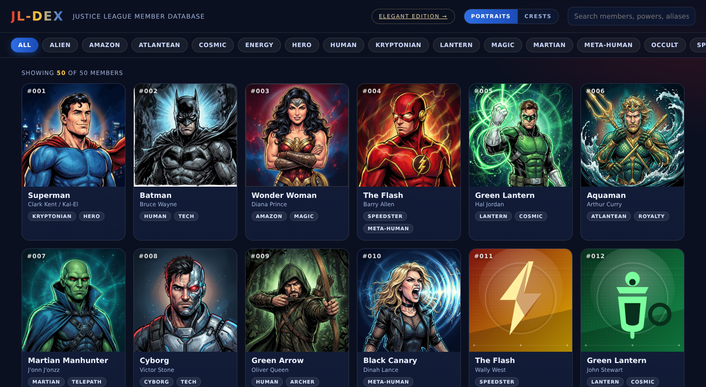
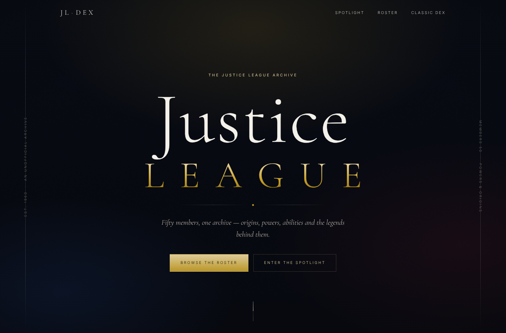

# JL-Dex

A Pokédex-style encyclopedia of **Justice League** members — image, codename, secret identity, origin,
vital stats, abilities and first appearance. Pure HTML/CSS/JS, no build step, no dependencies.



There are two front ends over the same member data:

| Edition | Page | Look |
| --- | --- | --- |
| Classic dex | `index.html` | dark hologram grid — fast scanning, type chips, quick detail card |
| **Elegant edition** | `elegant.html` | editorial archive — serif typography, gold hairlines, spotlight carousel, era filters |



## Features

- **50 members** — founders, JLI-era heroes, modern roster, Lanterns of every Earth, plus a few
  reformed villains who served on League teams.
- **Pokedex data sheet** per member: dex number, codename, real name, origin, height, weight,
  six-bar stat block (HP / ATK / DEF / SPD / INT / WIL), ability tags, bio and first appearance issue.
- **Search** across names, aliases, origins, types, powers and bios (multi-word, all terms must match).
- **Type filter** (Kryptonian, Lantern, Magic, Speedster, Alien, Tech, …).
- **Detail card** with keyboard support: `←` / `→` to walk the dex, `Esc` to close.
- Fully responsive, dark "hologram" UI, lazy-loaded art.

## Run it

Any static server works:

```bash
python3 -m http.server 8000
# then open http://localhost:8000
```

Opening `index.html` directly also works.

## Layout

```
index.html                 # classic dex page (hologram grid)
elegant.html               # elegant edition (editorial archive)
css/style.css              # classic dex theme
css/elegant.css            # elegant edition theme
css/fonts.css              # self-hosted @font-face declarations
js/data.js                 # member records (the "dex" database)
js/app.js                  # classic dex behaviour
js/elegant.js              # elegant edition behaviour (spotlight, roster, entry sheet)
js/accents.js              # per-member accent palette (generated)
images/*.svg               # 50 generated member crests
fonts/*.woff2              # Cormorant Garamond + Inter, latin subsets (OFL 1.1)
tools/generate_emblems.py  # regenerates images/*.svg and js/accents.js
```

## The elegant edition

`elegant.html` is a slower, more ceremonial reading of the same fifty records:

- **Hero** with a drifting starfield, gold-foil wordmark and hairline rails.
- **Spotlight** — one member at a time: medallion, era, vitals, animated stat lines,
  abilities and bio, with ‹ › paging and a progress hairline. Hovering pauses the cycle.
- **Roster** — serif cards in a restrained grid, founding members marked with a gold
  diamond, era filters (Golden / Silver / Bronze / Modern), A–Z or dex order, live search.
- **Entry sheet** — full-page reading view with `←`/`→` to turn pages and `Esc` to close.
- Type is **Cormorant Garamond** (display) and **Inter** (small caps), self-hosted so the
  page works offline; both are SIL Open Font License 1.1 (see `fonts/LICENSE-OFL.txt`).

## Adding a member

1. Add an entry to the `window.JLDEX` array in `js/data.js` (see an existing record for the shape).
2. For the crest: add a slug + colours to the `M` table in `tools/generate_emblems.py` and run
   `python3 tools/generate_emblems.py`.
3. For a portrait: drop a square `images/heroes/<slug>.jpg` and run
   `python3 tools/index_portraits.py` — the pages pick it up with no further changes.

## Art

Two interchangeable art styles, switchable from the top bar (**Portraits / Crests**):

- **Portraits** — comic-style character portraits in `images/heroes/*.jpg`, one per member
  (720×720, square head-and-shoulders framing in a single house style). The classic dex uses
  them as the card art; the elegant edition uses them for the medallion, the spotlight and the
  roster, and shows the crest as a small "archive crest" plate on each entry.
- **Crests** — the original vector emblems in `images/*.svg`, generated by
  `tools/generate_emblems.py` (shield, bat, bolt, lantern, trident, hawk, …).

The chosen style is stored in `localStorage`; members that have no portrait yet fall back to
their crest automatically, so the pages never request a file that does not exist
(`js/portraits.js` is the index, rebuilt with `python3 tools/index_portraits.py`).

## Data note

Character names, identities, origins and powers are summarised from published DC Comics material and
are the property of DC Comics / Warner Bros. This is a non-commercial fan reference.

## License

MIT — see [LICENSE](LICENSE).
